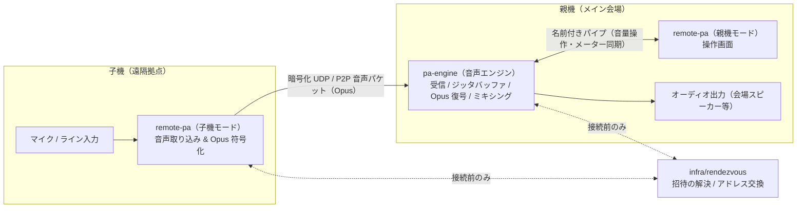

# VOCROZ の開発に参加する方へ

この文書は、VOCROZ を開発する人向けの技術情報をまとめたものです。
製品の紹介は [README.md](README.md) にあります。

コードの書き方、ファイルの置き場所、レビューの基準などの開発ルールは [AGENTS.md](AGENTS.md) が正本です。
製品要求・実装仕様書は [docs/spec](docs/spec/)、設計判断の記録は [docs/adr](docs/adr/) にあります。

---

## システム構成

| プログラム | モード / 役割 | 処理内容 |
| :--- | :--- | :--- |
| **`pa-engine`** | **親機音声エンジン** | 子機からの音声パケット受信、ジッタバッファ処理、**Opus 復号（decoding）**、ミキシング、オーディオ出力を行います。セッションと参加者の状態もここで管理します。（※Opus 符号化は行いません） |
| **`remote-pa`** | **親機モード**（操作画面） | ミキサー画面の表示と、名前付きパイプ経由での `pa-engine` の操作・メーター表示を行います。音声データは扱いません。 |
| **`remote-pa`** | **子機モード**（音声送信） | マイク／ライン入力の取り込み、**Opus 符号化（encoding）**、および親機へのパケット送信を行います。 |
| **`pa-updater`** | **アップデート** | セッション終了後にだけ起動し、署名を検証してから更新を適用します。 |
| **`infra/rendezvous`** | **接続仲介サーバー** | 招待コードの解決と、子機と親機が直接つながるためのアドレス交換を行います。音声は通しません。 |



---

アーキテクチャ、責務の分け方、依存関係の作り方、ファイルの置き場所は AGENTS.md 第 2 節から第 7 節を参照してください。

---

## ビルド

必要なもの: CMake 3.25 以上、C++20 対応コンパイラ（Windows では Visual Studio 2022）、Go 1.22 以上。

```bash
# C++ のビルドとテスト
cmake -S . -B build -DCMAKE_BUILD_TYPE=Release
cmake --build build --config Release
ctest --test-dir build -C Release

# ランデブーサーバーのテスト
cd infra/rendezvous && go test ./...
```

CMake の構成時に、コミット前の自動整形（`.githooks/pre-commit`）が有効になります。CMake を使わずに作業する場合は、最初に `git config core.hooksPath .githooks` を実行してください。

現時点では各プログラムとも `--version` に応答するだけです。親機・子機としての起動手順は、機能の実装に合わせてこの節に追記します。

---

## リポジトリの初期設定

初期設定の Pull Request をマージしたあと、リポジトリで次の 3 つを実行してください。

1. **Repository setup ワークフローの実行**
   - GitHub の **Actions** タブから **Repository setup** を選び、手動実行（`workflow_dispatch`）してラベルとマイルストーンを反映します。
2. **`@claude` 用の Secrets 登録**
   - **Settings → Secrets and variables → Actions** で、`CLAUDE_CODE_OAUTH_TOKEN`（手元で `claude setup-token` を実行して発行）または `ANTHROPIC_API_KEY` を登録し、[Claude GitHub App](https://github.com/apps/claude) をインストールします。
3. **ブランチ保護の設定**
   - **Settings → Branches**（または **Rules → Rulesets**）で、デフォルトブランチに保護ルール（PR 必須、CI チェック通過必須、Force Push 禁止など）を設定します。

## 言語

`AGENTS.md` 8.1 に従い、コード内のコメントおよびドキュメント（README.md と本書を含む）はすべて**日本語**で記述します。

---

## 作業の流れ

1. Issue を立てる（テンプレートは「機能」「不具合」「配置のずれ」の 3 種類）。
2. `<種類>/<短い説明>` の名前でブランチを切る（例: `feat/jitter-buffer`）。
3. Conventional Commits 形式でコミットし、PR テンプレートを埋めて `Closes #<Issue 番号>` を書く。
4. CI が緑になったらマージする。`main` へ直接 push しない。

Issue や PR のコメントで `@claude` と書くと、Claude Code が AGENTS.md に従って作業します。
詳しくは AGENTS.md 第 16 節を参照してください。
