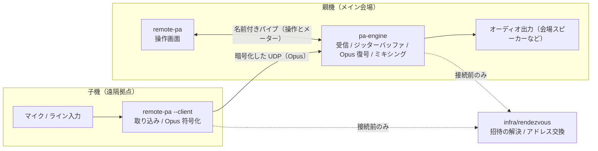

# VOCROZ

離れた場所にある複数の子機（マイクやライン入力をつないだ PC）からインターネット経由で音声を集め、親機でミキシングして会場のスピーカーや配信へ出力するリモート PA システムです。
離れた場所にいる演奏者どうしの合奏にも使えるよう、遅延を小さく抑えることを重視しています。

> 現在開発中で、まだ提供していません。

---

## 特徴

### 操作画面が落ちても音が止まらない

一般的なソフトウェアミキサーは画面の描画と音声処理が同じプロセスで動くため、画面が固まると音声出力も一緒に止まります。
VOCROZ は、親機の音声処理エンジン（`pa-engine`）と操作画面（`remote-pa`）を別のプロセスに分けています。操作画面が固まっても、`pa-engine` は受信、復号、ミキシング、出力を続けます。

### ケーブルなしで複数拠点の音声を低遅延に集められる

各拠点の PC で `remote-pa` を子機モードで起動すると、マイクやライン入力を Opus で符号化して親機へリアルタイムに送ります。
親機の `pa-engine` は、ジッターバッファで通信の揺らぎを吸収しながら各子機の音声を復号し、ミキシングします。長いケーブルや専用の伝送機器を用意しなくても、インターネットだけで複数拠点の PA を組めます。

### 親機と子機を 1 つのアプリで扱える

`remote-pa` は起動のしかたを変えるだけで、親機の操作画面としても、遠隔拠点の子機としても動きます。機材ごとに別のソフトを管理する必要はありません。

### 本番で事故を起こさない

- 親機が参加を承認するまで、子機の音は入りません。
- 起動時や新しい子機の接続時は、各チャンネル、Master、子機の送信がすべてミュートから始まります。
- 出力中のオーディオインターフェースが抜けても、別のスピーカーへ勝手に切り替えず、Master をミュートします。
- 回線が一時的に切れた子機は、元のチャンネルに自動で戻ります。

---

## 機能一覧

| カテゴリ | 機能 | 説明 | 状態 |
| :--- | :--- | :--- | :---: |
| 音声送信（子機） | 音声の取り込みと Opus 符号化 | マイクやライン入力を取り込み、Opus に符号化して親機へ送る | 開発中 |
| 音声受信（親機） | 受信と Opus 復号 | 届いた音声をジッターバッファで整列し、復号する | 開発中 |
| ミキシング | チャンネル制御と Master 出力 | 子機ごとのフェーダーとミュートを調整し、オーディオインターフェースから出力する（8 チャンネル以上） | 開発中 |
| 監視 | レベルメーターと通信状態 | 各チャンネルのレベル、接続状態、音の途切れやパケットロスの警告を確認する | 開発中 |
| 接続 | 招待と承認 | 招待 URL やコードで子機が参加を申請し、親機が承認する | 開発中 |
| 運用 | アプリ内アップデート | 本番中は適用せず、セッション終了後に更新する | 開発中 |
| ルーティング | モニター返しとマトリクス | 子機ごとのマイナスワン返し、AUX、バス、マトリクスによるルーティング | 予定 |
| 録音と再生 | マルチトラック録音 | チャンネルやバスごとの録音（WAV、FLAC）と音声ファイルの再生 | 予定 |
| 外部連携 | SRTP 送出と仮想オーディオデバイス | 外部機器への SRTP 送出、配信ソフトや通話アプリとの音のやり取り | 予定 |
| エフェクト | VST3 | VST3 エフェクトと VST3 インストゥルメント、MIDI 入力 | 予定 |
| 映像 | 画面キャプチャと録画 | 画面やウィンドウの取り込み、音声に同期した録画 | 予定 |

「予定」の機能は、画面にボタンだけを置いています。押すと「開発中」と表示されるだけで、設定や音声は変わりません。

---

## システム構成

| プログラム | 役割 | 処理内容 |
| :--- | :--- | :--- |
| `pa-engine` | 親機の音声エンジン | 受信、ジッターバッファ、Opus 復号、ミキシング、オーディオ出力。セッションと参加者の状態もここで管理する（Opus 符号化は行わない） |
| `remote-pa` | 親機の操作画面 | ミキサー画面の表示と、`pa-engine` の操作。音声データは扱わない |
| `remote-pa --client` | 子機 | マイクやライン入力の取り込み、Opus 符号化、親機への送信 |
| `pa-updater` | アップデート | セッション終了後にだけ起動し、署名を確かめてから更新する |
| `infra/rendezvous` | 接続の仲介サーバー | 招待コードの解決と、子機と親機が直接つながるためのアドレス交換。音声は通さない |



---

## ビルド

必要なもの: CMake 3.25 以上、C++20 に対応したコンパイラ（Windows では Visual Studio 2022）、Go 1.22 以上。

```sh
cmake -S . -B build -DCMAKE_BUILD_TYPE=Release
cmake --build build --config Release
ctest --test-dir build -C Release

cd infra/rendezvous && go test ./...
```

現時点では各プログラムとも `--version` に応答するだけです。

---

## GitHub での開発

開発のルールは [AGENTS.md](AGENTS.md) にあります。コメントとドキュメントは日本語で書きます。

最初の PR をマージしたあと、リポジトリで次の 3 つを行ってください。

1. **Repository setup の実行**: Actions タブから「Repository setup」を選んで手動実行し、ラベルとマイルストーンを作ります。
2. **`@claude` 用の Secrets の登録**: Settings → Secrets and variables → Actions に `CLAUDE_CODE_OAUTH_TOKEN`（手元で `claude setup-token` を実行して発行）か `ANTHROPIC_API_KEY` を登録し、[Claude GitHub App](https://github.com/apps/claude) をインストールします。
3. **ブランチ保護の設定**: Settings → Branches（または Rules → Rulesets）で、main に「PR 必須」「CI の成功必須」「Force push 禁止」を設定します。

---

## ライセンス

[GNU Affero General Public License v3.0](LICENSE) で公開しています。配布するバイナリには、対応するソースコードの入手先を示します。
