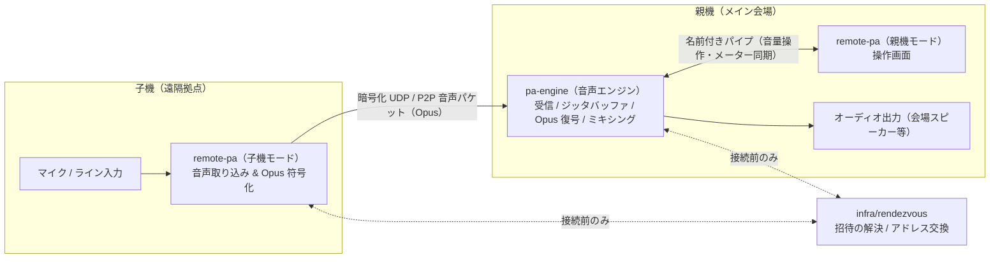

# VOCROZ

離れた場所にある複数の子機（マイク・ライン入力端末）からネットワーク経由で音声を集め、親機でミキシングして会場スピーカー等へ出力するリモート PA（Public Address）システムです。

> 現在開発中のため、下記の機能はまだ利用できません。

---

## 特徴

### 1. 画面（UI）が落ちても音が止まらないプロセス分離設計
一般的なソフトウェアミキサーは、画面描画と音声処理が同じプロセスで動くため、UI がフリーズしたりクラッシュしたりすると音声出力も一緒に止まります。
VOCROZ では、親機の**音声処理エンジン（`pa-engine`）**と**操作画面（`remote-pa`）**を別プロセスとして完全に分離しています。万が一操作画面が固まっても、`pa-engine` は裏でそのまま音声の受信・復号・ミキシング・出力を続けます。

### 2. 長距離ケーブルなしで複数拠点の音声を低遅延に集約
各拠点の PC で `remote-pa` を**子機モード**として起動するだけで、マイクやライン入力を **Opus で符号化（encoding）** して親機へリアルタイム送信します。
親機の `pa-engine` は複数子機からのパケットを受信し、ジッタバッファで通信の揺らぎを吸収しながら **Opus 復号（decoding）** とミキシングを行います。長いアナログケーブルや専用の音声伝送ハードウェアを用意せずに、インターネットだけで複数拠点の PA 環境を組めます。

### 3. 1つのアプリで「親機 UI」と「子機」の両方に対応
`remote-pa` は起動モードを切り替えるだけで、メイン会場の**親機コンソール画面**としても、遠隔拠点の**子機（音声送信機）**としても動作します。機材ごとに別々の専用ソフトを管理する必要がありません。

### 4. 離れた場所どうしの合奏にも使える低遅延設計
音の遅れをできるだけ小さくすることを最優先に設計しています。会場への音声集約だけでなく、自宅や別々のスタジオにいるメンバーどうしのリハーサルや合奏にも使えます。

### 5. 本番で事故を起こさない安全設計
- 親機が参加を**承認**するまで、子機の音は一切入りません。
- 起動時や新しい子機の接続時は、各チャンネル・Master・子機の送信がすべて**ミュートから開始**します。不意の大音量は出ません。
- 出力中のオーディオインターフェースが抜けても、PC 内蔵スピーカー等へ勝手に切り替えず、Master をミュートして知らせます。
- 回線が一時的に切れた子機は、**元のチャンネルに自動で復帰**します。チャンネルが増えたり並び順が変わったりしません。
- エラーや参加申請は画面をふさがない通知で知らせるため、ミキシングを止めずに対応できます。

### 6. 出演者の操作はシンプル
出演者は招待 URL を開いてマイクを選ぶだけで参加できます。親機のミキサーやルーティングは子機から操作できないため、出演者の誤操作で本番の音が崩れることはありません。

---

## 機能一覧

| カテゴリ | 機能 | 説明 | 状態 |
| :--- | :--- | :--- | :---: |
| **音声送信（子機）** | 音声キャプチャ & Opus 符号化 | 子機のマイク／ライン入力を取り込み、Opus に符号化して親機へ送信する（`remote-pa` 子機モード） | 準備中 |
| **音声受信（親機）** | パケット受信 & Opus 復号 | 子機から届いたパケットをジッタバッファで整列し、Opus 復号して音声に戻す（`pa-engine`） | 準備中 |
| **ミキシング** | チャンネル制御・マスター出力 | 子機ごとの音量（Fader）・ミュートを調整し、親機のオーディオ出力へミックスする（8 チャンネル以上） | 準備中 |
| **監視・メーター** | レベルメーター・通信状態監視 | 各チャンネルの音量レベルや、接続状態・パケットロス状況を画面で確認する | 準備中 |
| **接続** | 招待・承認・自動再接続 | 招待 URL／コードで子機が参加を申請し、親機が承認する。切断時は同じチャンネルへ自動復帰する | 準備中 |
| **運用** | アプリ内アップデート | 更新を通知し、本番中は適用せずセッション終了後に更新する | 準備中 |
| **ルーティング** | AUX センド・モニター返し | マトリクスによるルーティング、子機ごとのマイナスワン返し | 今後対応 |
| **録音・再生** | マルチトラック録音・ファイル再生 | 各チャンネル・バスの録音（WAV／FLAC）と音声ファイルの再生 | 今後対応 |
| **外部連携** | SRTP 送出・仮想オーディオデバイス | 外部機器への SRTP 送出、配信ソフトや通話アプリとの音声のやり取り | 今後対応 |
| **エフェクト・音源** | VST3・MIDI | VST3 エフェクト／インストゥルメントの読み込み、MIDI 入力 | 今後対応 |
| **映像** | 画面キャプチャ・録画 | 画面やウィンドウの取り込みと、音声に同期した録画 | 今後対応 |

---

## Alpha 版の仕様と制限事項

- **接続状態の表示**: NAT 越え（NAT Traversal）に失敗した場合や実際の音声通信が確立できていない場合、画面上で「接続済み」と誤表示せず、未接続またはエラー状態として原因と対処方法を表示します。
- **未実装機能の表示**: 上記一覧で「今後対応」となっている機能のボタンは画面に配置しますが、押しても「**開発中**」と通知されるだけで、空のウィンドウを開いたり設定を変えたりはしません。

---

## システム構成

| プログラム | モード / 役割 | 処理内容 |
| :--- | :--- | :--- |
| **`pa-engine`** | **親機音声エンジン** | 子機からの音声パケット受信、ジッタバッファ処理、**Opus 復号（decoding）**、ミキシング、オーディオ出力を行います。セッションと参加者の状態もここで管理します。（※Opus 符号化は行いません） |
| **`remote-pa`** | **親機モード**（操作画面） | ミキサー画面の表示と、名前付きパイプ経由での `pa-engine` の操作・メーター表示を行います。音声データは扱いません。 |
| **`remote-pa`** | **子機モード**（音声送信） | マイク／ライン入力の取り込み、**Opus 符号化（encoding）**、および親機へのパケット送信を行います。 |
| **`pa-updater`** | **アップデート** | セッション終了後にだけ起動し、署名を検証してから更新を適用します。 |
| **`infra/rendezvous`** | **接続仲介サーバー** | 招待コードの解決と、子機と親機が直接つながるためのアドレス交換を行います。音声は通しません。 |



---

## 動作環境

- Windows 11 / Windows 10（64 ビット）
- インターネット接続（光回線などの固定回線を推奨）

---

## ビルド

必要なもの: CMake 3.25 以上、C++20 対応コンパイラ（Windows では Visual Studio 2022）、Go 1.22 以上。

```bash
# C++ のビルドとテスト
cmake -S . -B build -DCMAKE_BUILD_TYPE=Release
cmake --build build --config Release
ctest --test-dir build -C Release

# ランデブーサーバーのテスト
cd infra/rendezvous && go test ./...
```

現時点では各プログラムとも `--version` に応答するだけです。親機・子機としての起動手順は、機能の実装に合わせてここに追記します。

---

## GitHub での開発

初期設定の Pull Request をマージしたあと、リポジトリで以下の3つを実行してください。

1. **Repository setup ワークフローの実行**
   - GitHub の **Actions** タブから **Repository setup** を選び、手動実行（`workflow_dispatch`）してラベルとマイルストーンを反映します。
2. **`@claude` 用の Secrets 登録**
   - **Settings → Secrets and variables → Actions** で、`CLAUDE_CODE_OAUTH_TOKEN`（手元で `claude setup-token` を実行して発行）または `ANTHROPIC_API_KEY` を登録し、[Claude GitHub App](https://github.com/apps/claude) をインストールします。
3. **ブランチ保護の設定**
   - **Settings → Branches**（または **Rules → Rulesets**）で、デフォルトブランチに保護ルール（PR 必須、CI チェック通過必須、Force Push 禁止など）を設定します。

### 言語ルール
- `AGENTS.md` 7.1 に従い、コード内のコメントおよびドキュメント（本 `README.md` を含む）はすべて**日本語**で記述します。

---

## ライセンス

[GNU Affero General Public License v3.0](LICENSE) で公開しています。配布するバイナリには、対応するソースコードの入手先を示します。
